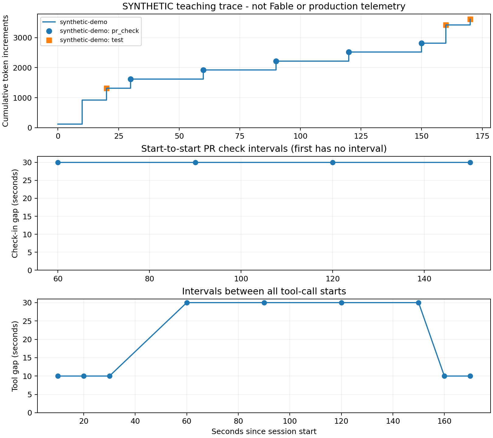

# Listening in on coding sessions with Python

An offline, small investigation for PyData NYC, October 27, 2026, using
fictional coding-session data.
No Code Telemetry account, API key, network calls or agent are needed at runtime.

## Run (Python 3.10+, verified on 3.12)

Clone the repository and open a terminal in it (or download and extract the
GitHub ZIP):

```sh
git clone https://github.com/CodeTelemetry/coding-agent-session-lab.git
cd coding-agent-session-lab
```

```sh
python3 -m venv .venv
source .venv/bin/activate
# Windows PowerShell: .venv\Scripts\Activate.ps1
python -m pip install -r requirements.txt
python -m unittest -v test_analysis
python analyze.py
```

Installation requires package access; analysis is offline afterwards. Dependencies
are pinned to the pandas and Matplotlib versions used to verify this lab. They
bring their normal transitive dependencies.

Open `output/investigation.png` and `output/summary.json`. Precomputed outputs are
included so the findings can also be inspected without installing packages.
`python analyze.py --data data/events_synthetic.csv --out another_output` writes
results elsewhere. The input format deliberately accepts synthetic rows only;
a production adapter would need separately validated units and provenance.

## Explore and edit during the lab

See [DEMO.md](DEMO.md) for copyable commands and live edits. Start an interactive
Python session with the data already loaded:

```sh
python -i explore.py
```

`df` contains all ten analyzed rows; `checks` contains just the PR checks.

[Download the attendee handout](attendee_handout.pdf).



## What the program calculates

`analyze.py` is the executable demonstration: `groupby`, `diff`, `cumcount`,
`cumsum` and three Matplotlib panels. There are only ten fixture rows.

* Tool gaps: successive tool-call start times, grouped by session.
* Check-in gaps: successive calls with the same session, tool and exact command.
* Repeats: every occurrence after the first of that exact key, even when other
  tools intervene. Repeated calls are distinct event IDs, not duplicate ingestion.
* Same-result repeats: compare the result with the preceding call of that key.
  The final poll changes from pending to pass; it is still a repeated call.
* Consumption: per-call token increments, summed within a session. Never sum an
  already cumulative counter or infer missing consumption as zero.
* Validation: inspect synthetic test exit codes. A missing exit code remains
  unknown, never a pass.

Expected synthetic results: 10 calls; 5 repeated calls overall; 5 PR check-ins,
4 repeats beyond the first, 3 unchanged results, 30-second median check-in gap;
3,620 token increments total, 1,500 attached to check-ins. Two synthetic test calls
have zero exits; another has no result. These are invented teaching values.

## Reproduce the inputs

```sh
python make_dataset.py          # exact deterministic synthetic CSV
python -m unittest -v test_analysis
python analyze.py
```

## Files and provenance

| File | Origin and role |
| --- | --- |
| `data/events_synthetic.csv` | Invented by `make_dataset.py`, fixed UTC timeline. Not Fable. |
| `output/events_analyzed.csv`, `checkins.csv` | Derived row-level metrics, with original IDs for inspection. |
| `output/summary.json`, `investigation.png` | Reproducible report and charts. |
| `attendee_handout.pdf` | Compact setup, method, results and evidence limits. |

No private customer telemetry, PR, account, prompt or repository data is bundled.
CSV schema: one row per distinct tool invocation; `(session_id,event_id)` unique;
`started_at` UTC timestamp; `tool`, exact `command`, retained result summary;
optional integer `exit_code` and nonnegative `duration_s`; required nonnegative
integer `tokens` incremental input-plus-output allocation; `provenance=synthetic`.
The token allocation is fictional and not derived from command output. Empty
result codes/durations mean not observed. Sorting is by session, start and event
ID (the event ID breaks simultaneous-start ties deterministically).

## License

MIT; see [LICENSE](LICENSE).

## Interpretation limits

Repeated checks can be reasonable polling. Unchanged output does not establish
that nothing useful happened. Gaps are not idle time, command duration, or human
waiting time; no interval is imputed before the first observed start. Token
counts are not dollars, CPU time or unique context size. The fixture is complete
by construction; a production trace might be incomplete or sampled. A test exit
and retained output support particular assertions, not overall correctness,
usefulness, causation, or a productivity score. The fixture is invented; it is not an observed agent edit or improvement sequence.
